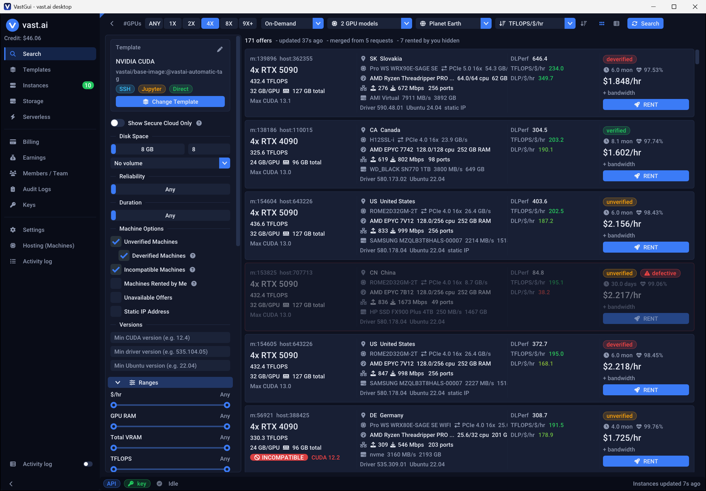

<div align="center">


# VastGui

**A fast, native desktop app for renting and managing GPUs on [vast.ai](https://vast.ai).**

Find the best GPU offers, rent them and keep an eye on your instances - without a browser, Python or the `vastai` CLI.

[](https://github.com/Efeuextrakt/VastGui/releases/latest)
[](https://github.com/Efeuextrakt/VastGui/actions/workflows/ci.yml)


[](LICENSE.md)

[Download](#download) · [Features](#highlights) · [Quick start](#quick-start) · [Docs](#documentation) · [Build from source](docs/BUILDING.md)



</div>

## Why VastGui?

The vast.ai web console is fine for a quick look. VastGui is for when you compare dozens of machines, care about
price per performance and want to manage a fleet of instances from one window:

- **Better search results.** vast.ai returns a *random sample* of matching offers per request. VastGui sends several
  requests and merges them, so the truly best offers actually show up ([why](docs/FEATURES.md#search-completeness)).
- **Price per performance at a glance.** TFLOPS/$/hr and DLP/$/hr for every offer and instance, colour-coded from
  best to worst.
- **Bad machines filtered out.** Low reliability, missing specs, performance far below the GPU model's median or
  machines you blacklisted are hidden (or shown with a *defective* tag) automatically.
- **One small exe.** A single ~5 MB `VastGui.exe` - no installer, no runtime, no Python. Starts instantly, never
  blocks while requests run.

## Highlights

| Area | What you get |
|------|--------------|
| **Search** | GPU count, models, region, rental type (on-demand / interruptible / reserved), 20 range sliders, raw vastai queries, presets, card or table view |
| **Metrics** | TFLOPS/$/hr and DLP/$/hr with percentile colouring; sort by any of them |
| **Defect filter** | reliability threshold, missing/zero key specs, outliers vs. the model median, machine/host blacklist |
| **Templates** | your own, recommended and searchable templates; incompatible offers (CUDA, GPU RAM, ...) are flagged |
| **Instances** | start/stop/reboot/destroy in bulk, outbid detection, live logs, SSH/SCP/Jupyter, snapshots, cloud copy, usage bars, $/hr history |
| **Reserved discounts** | 1/3/6-month prepay plans with the real discount, like the web console |
| **Everything else** | storage volumes, serverless endpoints & worker groups, billing & earnings charts with CSV export, team & roles, audit logs, SSH/API keys, env-var secrets, hosting your own machines |
| **Activity log** | every API request and error, filterable and exportable |

Full list: [docs/FEATURES.md](docs/FEATURES.md).

## Download

1. Grab `VastGui-<version>-win64.zip` from the [latest release](https://github.com/Efeuextrakt/VastGui/releases/latest).
2. Unzip anywhere and run `VastGui.exe`.

Requirements: 64-bit **Windows 10 or 11**. Nothing to install - the exe only uses Windows system DLLs.
Want it portable (settings next to the exe, e.g. on a USB stick)? Put an empty `VastGui.json` beside `VastGui.exe`.

Linux works too (GLFW + OpenGL 3) but has to be [built from source](docs/BUILDING.md).

## Quick start

1. **Get an API key** at <https://cloud.vast.ai/manage-keys/> (offer search also works without one, limited to 64
   offers per request).
2. Open **Settings → Account / API key**, paste the key and press **Save key** (or set the `VAST_API_KEY`
   environment variable). **Test key** shows your user name and credit.
3. On **Search**, pick GPU count, models and region, choose a sort (e.g. *TFLOPS/$/hr*) and press **Search**.
4. Click **Change Template** to choose what to run, then **RENT** on an offer.
5. Watch it come up on **Instances** - logs, SSH command and Jupyter are one click away.

## Security & privacy

- VastGui talks **directly to the vast.ai API** over HTTPS - no third-party servers, no telemetry.
- Your API key is **stored encrypted** (XChaCha20-Poly1305) and never logged, shown or sent anywhere but vast.ai.
- Requests that create something (like renting an instance) are never retried automatically, so you are never
  charged twice.

Details: [docs/CONFIGURATION.md](docs/CONFIGURATION.md).

## Documentation

| Document | Contents |
|----------|----------|
| [Features](docs/FEATURES.md) | every page and option, how search merging works |
| [Configuration & security](docs/CONFIGURATION.md) | API key storage, files written, how the API is used |
| [Building from source](docs/BUILDING.md) | Windows (MinGW / MSVC) and Linux builds, tests, project layout, diagnostics |
| [DLL dependencies](docs/DLL_DEPENDENCIES.md) | why the exe imports each Windows system DLL |
| [Changelog](CHANGELOG.md) | release notes |
| [Third-party licenses](THIRD_PARTY_LICENSES.txt) | full license texts of all bundled components |

## Build from source

```bat
build.bat          :: release build -> VastGui.exe   (MinGW-w64 g++ 13+, CMake, Ninja)
build.bat run      :: build, then launch VastGui.exe
build.bat test     :: build and run the unit tests
```

All dependencies are vendored in `third_party/`. MSVC and Linux instructions: [docs/BUILDING.md](docs/BUILDING.md).

## Built with

[Dear ImGui](https://github.com/ocornut/imgui) (docking) · [ImPlot](https://github.com/epezent/implot) ·
[nlohmann/json](https://github.com/nlohmann/json) · [Monocypher](https://monocypher.org) ·
[doctest](https://github.com/doctest/doctest) · [IconFontCppHeaders](https://github.com/juliettef/IconFontCppHeaders) ·
Font Awesome Free, Roboto and Cousine fonts.

These keep their own permissive licenses (MIT, zlib, BSD-2-Clause/CC0, Apache 2.0, SIL OFL 1.1, CC BY 4.0); full
texts are in [THIRD_PARTY_LICENSES.txt](THIRD_PARTY_LICENSES.txt), `third_party/` and [res/fonts/](res/fonts/LICENSES.md).

## AI assistance

Large parts of this code were written with AI coding assistants and then reviewed, tested and put together by the
author. Bug reports are welcome.

## License

VastGui is licensed under the [MIT License](LICENSE.md).

The bundled third-party components remain under their own licenses (see above).

---

<sub>VastGui is an independent project and is not affiliated with or endorsed by Vast.ai. "vast.ai" is used only
to describe what the app connects to.</sub>
