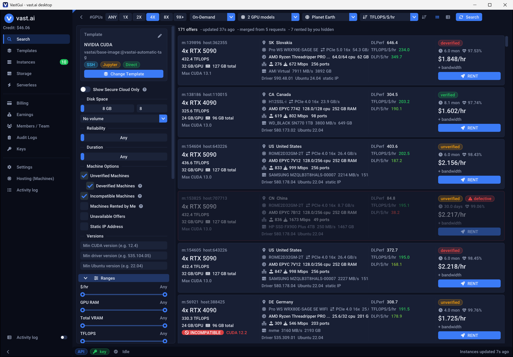

# Features

[← Back to the README](../README.md)

## Search (main page)

- #GPUs toggles, rental type (on-demand / interruptible / reserved), multi-select GPU model picker with search,
  region (planet / continent / country), sort (price, TFLOPS/$/hr, DLP/$/hr, reliability, inet, disk bandwidth,
  duration, VRAM, CUDA) with asc/desc, card view or a sortable, resizable, reorderable, hideable table.
- Filter panel with template box (change/edit template), secure cloud, disk size + volume, reliability,
  duration, machine options, CUDA/driver/Ubuntu minimums, 20 min/max range sliders, raw query box (vastai query
  syntax), presets.
- **Metrics**: `TFLOPS/$/hr = total_flops / dph_total`, `DLP/$/hr = dlperf / dph_total` (higher is better),
  colour-coded green -> red by percentile within the current result set; missing values show `—`.
- **Defective machine filter** (on by default, thresholds in Settings): reliability below X %
  (default 90 %), missing/zero `inet_down`, `inet_up`, `total_flops`, `dlperf`, `disk_bw`, `cuda_max_good`,
  DLPerf or TFLOPS per GPU more than 40 % below the median of the same GPU model in the current results
  (needs >= 3 samples of that model), or a blacklisted machine/host. A deverified status alone is *not* a defect -
  you decide by blacklisting machines (Ban button on the Instances page, or an offer's right-click menu).
  The filter panel shows how many offers are hidden and can show them greyed out instead.
  Deverified offers are only listed when *Unverified Machines* and its sub-option *Deverified Machines* are ticked.
- **Incompatible machines**: offers that fail the selected template's requirements (its `extra_filters`, e.g.
  `gpu_ram >= 40000`, plus the CUDA version in the image tag such as `...-cuda12.4`) get a red *INCOMPATIBLE*
  badge (card) or a red marker (table); the tooltip lists the unmet requirements. With *Incompatible Machines*
  unticked they are hidden. A template without requirements makes no offer incompatible (see the `?` help).
- **Machines rented by me**: offers on machines where you already have an instance (running, loading or stopped)
  are hidden; tick *Machines Rented by Me* to show them with a *RENTED BY YOU* badge.
- **Template picker** (Search -> *Change Template*): tabs *My templates* (first; yours, public and private),
  *Recommended* and *Search*; select a row and press *Use selected*.
- **Rent dialog**: disk, label, bid price for interruptible, link/create volume and a one-line template summary
  with *Change...* (pick another template for this rental only; a warning shows if the machine does not meet its
  requirements); the template configuration (image/template hash, SSH/Jupyter/entrypoint + direct, env vars,
  ports, docker options, on-start script) is folded into a collapsed *Template settings* section.

## Search completeness

vast.ai does not return the true top offers for a search. Measured against the offers endpoint (Nov 2026):

- Without an API key every request is capped at **64 offers**, whatever `--limit` says. With a key the limit is
  honoured up to the full result size; `--limit 0` or no limit still gives 64.
- Each response is a **random sample** of the matching offers, correctly sorted. Small limits are not the best L
  offers: with limit 128 sorted by price only ~20% of the truly cheapest 10 offers were included.
- Multi-GPU machines are offered as 1/2/4/... GPU bundles, and every request picks other GPUs, so the **offer id
  changes**. An offer is identified by *machine + GPU count* instead.

VastGui therefore sends **5 identical requests with limit 1000** per search (Settings > Connection: *Offers per
request*; *Requests per search*, any value >= 1, recommended 3-10) and merges them, keeping one offer per machine +
GPU count (the cheapest).
Measured: 3 merged requests find the true best 10 offers and ~87% of the best 200, 4 find ~92% (a single
limit-128 request: ~20% / ~17%).
Ties are ordered by machine id, so equal values do not swap between searches. Results still vary slightly from
search to search because the server keeps sampling. Each request at limit 1000 downloads ~2.7 MB.

## Instances

- Status-coloured table (interruptible instances that should run but don't are shown as a red *outbid* badge
  that opens *Change bid*; also a status filter and a count in the header), bulk start/stop/reboot/destroy, label.
- Logs window: separate Instance / Daemon log tabs, line numbers, auto-refresh, save to file; tail defaults to
  1000 lines, -/+ step 1000, *Max* = 20000.
- Copy SSH command / SCP URL, open Jupyter, change bid, prepay, deposit, execute, copy files (between remote
  locations), cloud copy, snapshot, attach SSH key, create template from instance, recycle, update, blacklist the
  machine.
- GPU/CPU/VRAM/disk usage bars, TFLOPS/$/hr and DLP/$/hr per instance and an ImPlot $/hr sparkline per instance.
- **Reserved discount** (*Reserve* column / row menu *Add a Reserved Discount...*): a *Save NN%* badge shows the
  best discount the host offers (*Saved NN%* once reserved). It opens a dialog like the web console with
  1 / 3 / 6 month plans (price, discount, discounted $/hr; plans ending after the machine's offer end date are left
  out) or a custom amount, and needs a second confirmation because the credits are deducted immediately. Discount
  per prepaid month count t: `credit_discount_max * t / (t + 1)` (matches the server; 30-day months).

## Other pages

**Templates, Storage, Serverless, Billing, Earnings, Members/Team, Audit Logs, Keys, Hosting, Activity log,
Settings** - see the in-app pages. Every action logs the API request it sends (`> PUT /api/v0/...`, never the
request body) in the Activity log.

## User interface

- Nothing blocks the UI thread: all calls run on a `std::jthread` worker pool; results are delivered on the UI
  thread each frame. A running request spins the icon *inside* its own refresh/search button (fixed size, no
  layout shift); errors appear inline, as toasts and in the Activity log. The docked Activity window is toggled
  from the sidebar.
- Dialogs all have a close button (x) and close when you click anywhere outside them (the one-time *New API key*
  dialog only via x). Floating Logs / JSON windows also close on an outside click unless docked.
- Window size, position and docking layout are restored after a restart. Dark/light theme, accent colour,
  font size / UI scale, per-monitor DPI.
